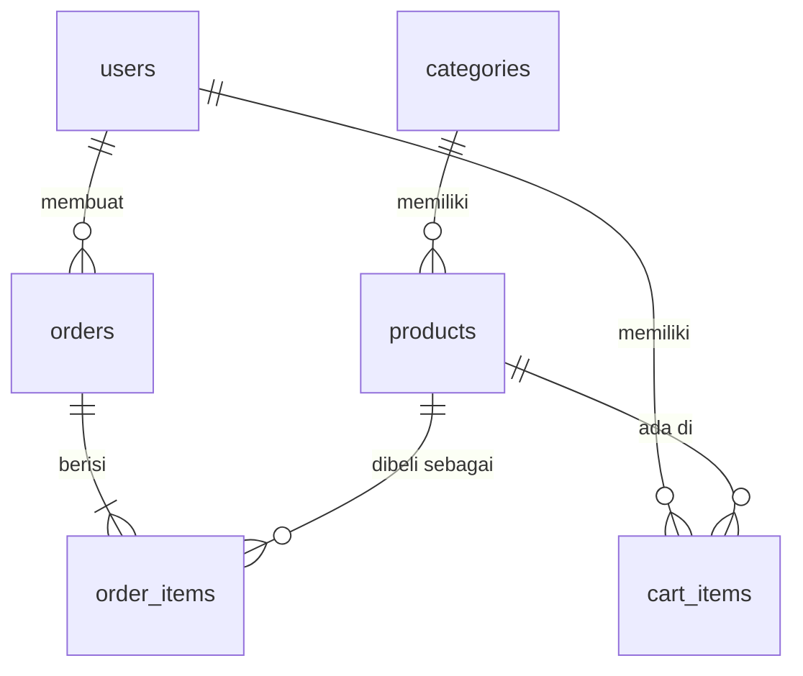

# ☕ KopiLihdia

Website e-commerce kopi dan camilan berbasis **Laravel** dengan pembayaran **Midtrans (Sandbox)**.
Dibuat sebagai Tugas Besar Praktikum Pemrograman E-Commerce, Program Studi Sistem Informasi.

## Fitur

**Pelanggan**
- Registrasi, login, logout, dan ubah profil
- Katalog menu, pencarian, filter kategori, dan detail produk
- Keranjang belanja (tidak bisa melebihi stok)
- Checkout dengan total dihitung ulang oleh server
- Pembayaran melalui Midtrans Snap (Sandbox)
- Riwayat pesanan, detail pesanan, dan invoice yang bisa dicetak

**Admin**
- Dashboard statistik (produk, kategori, pelanggan, pesanan, menunggu bayar, sudah dibayar)
- CRUD kategori (kategori yang masih punya produk tidak bisa dihapus)
- CRUD produk dengan upload gambar, harga, dan stok
- Manajemen pesanan: filter, detail, dan ubah status pemrosesan/pengiriman
- Status pembayaran hanya diperbarui otomatis dari Midtrans, tidak bisa diubah manual

## Teknologi
Laravel, MySQL, Eloquent ORM, Blade, Bootstrap 5, Midtrans Snap (`midtrans/midtrans-php`), PHPUnit.

## Instalasi

Prasyarat: PHP 8.3+, Composer, MySQL, Git (di Windows paling mudah memakai Laragon).

```bash
git clone https://github.com/Ariq22102005/kopi-lihdia.git
cd kopi-lihdia
composer install
cp .env.example .env        # Windows PowerShell: copy .env.example .env
php artisan key:generate
```

1. Buat database MySQL kosong bernama `kopi_lihdia` (collation `utf8mb4_unicode_ci`).
2. Sesuaikan koneksi database dan kunci Midtrans di `.env`:

```env
DB_CONNECTION=mysql
DB_HOST=127.0.0.1
DB_PORT=3306
DB_DATABASE=kopi_lihdia
DB_USERNAME=root
DB_PASSWORD=

MIDTRANS_SERVER_KEY=SB-Mid-server-xxxxxxxx
MIDTRANS_CLIENT_KEY=SB-Mid-client-xxxxxxxx
MIDTRANS_IS_PRODUCTION=false
```

Kunci Sandbox diambil dari https://dashboard.sandbox.midtrans.com (Settings, Access Keys).

3. Migrasi, data contoh, dan link storage:

```bash
php artisan migrate --seed
php artisan storage:link
php artisan serve
```

Buka http://localhost:8000.

## Akun demo

| Peran | Email | Password |
|---|---|---|
| Admin | `admin@kopilihdia.test` | `password` |
| Customer | `budi@example.com` | `password` |
| Customer | `siti@example.com` | `password` |

Seeder juga membuat 5 pesanan contoh dengan status berbeda (menunggu pembayaran, diproses, dikirim, selesai, kedaluwarsa). Akun ini hanya untuk demo.

## Alur pembayaran Midtrans

1. Customer membuat pesanan di checkout. Total dihitung server dari harga di database.
2. Di halaman pesanan, tombol **Bayar Sekarang** meminta Snap token ke server, lalu membuka popup Midtrans.
3. Midtrans mengirim notifikasi ke `POST /midtrans/notification`. Server memverifikasi `signature_key` (SHA512 dari `order_id + status_code + gross_amount + server_key`), memeriksa nominal sama dengan total pesanan, lalu memperbarui status.
4. Tombol **Cek Status Pembayaran** memakai Status API Midtrans sebagai cadangan, berguna di localhost karena Midtrans tidak bisa menembak alamat lokal.

Agar webhook asli bisa diterima saat pengembangan, jalankan tunnel (ngrok atau Cloudflare Tunnel) ke port 8000, lalu isi **Payment Notification URL** di dashboard Sandbox dengan `https://alamat-tunnel/midtrans/notification`.

Status pembayaran: `pending`, `paid`, `expired`, `failed`. Saat pembayaran `expired` atau `failed`, pesanan dibatalkan dan stok dikembalikan otomatis.

## Pengujian otomatis

Pengujian memakai database terpisah supaya data asli aman.

1. Buat database kosong `kopi_lihdia_test` (collation `utf8mb4_unicode_ci`).
2. Jalankan:

```bash
php artisan config:clear
php artisan test
```

Cakupan: kontrol akses admin/customer, validasi keranjang dan stok, checkout (total dari server, snapshot item, stok berkurang), verifikasi signature Midtrans (palsu ditolak, nominal tidak cocok ditolak, idempotent), dan aturan status pesanan admin.

## Struktur penting

```
app/Http/Controllers/        Controller customer, admin, auth, pembayaran
app/Http/Middleware/         AdminMiddleware (pembatasan hak akses)
app/Models/                  User, Category, Product, CartItem, Order, OrderItem
app/Services/                MidtransService, PaymentStatusUpdater
database/migrations/         Skema database
database/seeders/            Data contoh (user, katalog, pesanan)
resources/views/             Tampilan Blade
tests/Feature/               Pengujian fungsionalitas
```

## Skema database



## Keamanan
- Middleware `admin` membatasi halaman admin, role tidak pernah diambil dari input pengguna.
- Total pembayaran selalu dihitung ulang di server, tidak diterima dari browser.
- Notifikasi Midtrans diverifikasi dengan signature dan nominal sebelum diproses.
- Kunci Midtrans hanya di `.env` (tidak ikut repository).
- Transaksi database dengan penguncian baris mencegah dua pembeli berebut stok terakhir.
